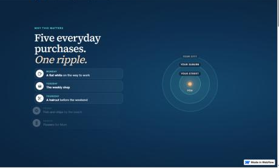
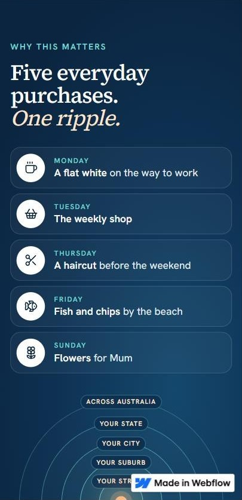

# Kindtill concept: results against a launch checklist

**A portfolio concept by Luka Skhiladze and Giorgi Kheladze. Kindtill is a fictional brand.** Copy marked "Draft copy" and the example causes are placeholders, not claims.

- Story page (Webflow, free plan, native interactions only): **https://bfg-spec.webflow.io**
- Registration form (Webflow Cloud app with its own database): **https://bfg-spec.webflow.io/register/**
- Form break tests, run on every change: [TEST-RESULTS.md](TEST-RESULTS.md) (27 of 27 passing)

Checked on 17 October 2026. "Live" means the published site above; "local" means the same app code running on a test machine against a fresh database.

## Launch checklist, line by line

The checks a site should pass before launch: devices and browsers, loading speed, keyboard access, reduced-motion options, links and form pathways, failed submissions and duplicate prevention, basic search info and agreed analytics.

| Checklist item | What was checked | How | Result |
|---|---|---|---|
| **Devices and browsers** | Story page and form at phone (375 and 390 px), tablet (768 px) and desktop (1440 px) widths | Chromium (desktop browser pane, live site); Chromium 141 via Playwright (local) | No sideways scrolling at any width; every section re-lays out for phones (single column, stacked tabs, two-column photo grid). Safari, Firefox and real phones are in the list below. |
| **Loading speed** | Mobile lab test of the concept and of four well-known storytelling sites, same profile, same morning, three runs each | PageSpeed Insights, Lighthouse 13.5, emulated Moto G Power on slow 4G | Story page: performance **81** (median of three), largest paint 3.7 s, layout shift 0.003, blocking time 0 ms. Form: **84**, blocking time 0 ms. The four reference sites: 35 to 62 ([table below](#loading-speed-mobile)). |
| **Keyboard access** | Story page by keyboard alone; the form completed by keyboard alone | Real key presses (live); Playwright (local, test 23) | Skip link first, then every link, tab and question in reading order, each with a visible focus ring. Audience tabs switch with the arrow keys. The Business path completed and confirmed without a mouse. |
| **Reduced-motion options** | The device's "reduce motion" setting on and off | Real setting on (live); setting overridden in a test copy of the live page (live); test 24 (local) | **On:** no scroll animations run and nothing is hidden. The ripple shows as one finished picture: five purchases, five rings, every label. **Off:** desktop gets the pinned, scroll-driven sequence; phones and tablets get unpinned step-by-step reveals. |
| **Links** | Every link on the story page, the three path links, the CMS item pages, the collection notice | Each URL requested on the live site | All return 200. The three path links open the form with that path already chosen. |
| **Form pathways** | One registration per path on the deployed app; each path's questions on their own | Live submissions with @example.com addresses (deleted afterwards); tests 1–4 (local) | Supporter, Business and Charity each saved with only their own questions. Answers from a path the visitor switched away from are neither sent nor stored. |
| **Failed submissions** | Simulated outage on the live app; offline, timeout and server error locally | Reviewer tools on the live form; tests 8–10 (local) | Every answer stays on screen and on the device. The visitor gets *Try again*, *Copy my answers* and *Email them instead*. *Try again* saves exactly once. |
| **Duplicate prevention** | Same email typed with different capitals and spaces; double-tap; two identical requests at the same moment; retry after a lost response | Live duplicate attempt; tests 5–7 and 11–12 (local, checked in the database) | One registration per email per path, enforced by the database. A repeat gets a message that reveals nothing stored, and the address on file is sent a manage link. |
| **Basic search info** | Page title and meta description on every page; social preview text on the home page | Page source on the live site | Set, and each one says it is a concept. The form pages also send `noindex`. The story page can't be kept out of search on the free plan (Webflow needs a paid site plan for that), so its title and description carry the concept label instead. |
| **Agreed analytics** | Not part of the concept | — | The free Webflow plan allows no scripts. For the real build: privacy-friendly events for *path chosen*, *form started* and *registration sent*, agreed with the client first. |
| **Accessibility** (supports the items above) | Automated WCAG 2.0–2.2 A/AA rules | axe-core 4.10 on the live story page at desktop and phone width, with every tab shown and every FAQ open; test 22 on five form states (local) | **0 issues** after one fix (a small grey note on a light background was darkened to pass contrast). Lighthouse accessibility: **100** on the story page and on the form (the form scored 96 until the reviewer-tools button was moved off the free-plan Webflow badge). |

## Loading speed (mobile)

PageSpeed Insights, mobile, Lighthouse 13.5.0, emulated Moto G Power on slow 4G. Three runs per page on 17 October 2026, between 06:32 and 07:07 (GMT+4). Lab scores move from run to run, so each row is the median run by performance score, with the range of the three scores beside it. Each page name links to its median report.

| Page | Performance (range) | Accessibility | Best practices | SEO | First paint | Largest paint | Blocking time | Layout shift |
|---|---|---|---|---|---|---|---|---|
| [**Concept story page**](https://pagespeed.web.dev/analysis/https-bfg-spec-webflow-io/4aa1zkv0k5?form_factor=mobile) | **81** (79–83) | **100** | **100** | **100** | 3.5 s | 3.7 s | 0 ms | 0.003 |
| [**Concept form**](https://pagespeed.web.dev/analysis/https-bfg-spec-webflow-io-register/32du4buwum?form_factor=mobile) (/register/) | **84** (84–84) | **100** | **100** | 63\* | 2.3 s | 4.0 s | 0 ms | 0 |
| [xrecruiter.io](https://pagespeed.web.dev/analysis/https-xrecruiter-io/4zjgtpdnf1?form_factor=mobile) | 35 (30–47) | 76 | 54 | 100 | 3.8 s | 24.1 s | 1,130 ms | 0.044 |
| [thankyou.co](https://pagespeed.web.dev/analysis/https-thankyou-co/qq4e88xbhg?form_factor=mobile) | 58 (49–68) | 77 | 73 | 92 | 2.5 s | 11.7 s | 350 ms | 0.063 |
| [kivawellness.com.au](https://pagespeed.web.dev/analysis/https-kivawellness-com-au/5uffoz67it?form_factor=mobile) | 43 (37–68) | 96 | 73 | 100 | 3.2 s | 9.8 s | 890 ms | 0 |
| [pledge1percent.org/how-it-works](https://pagespeed.web.dev/analysis/https-pledge1percent-org-how-it-works/uzc2zn37ke?form_factor=mobile) | 62 (55–64) | 97 | 96 | 92 | 2.7 s | 4.1 s | 60 ms | 0.448 |

\* The form is deliberately kept out of search (`noindex`), which Lighthouse counts against SEO.

What still holds the concept back:

- **Story page:** about 2.7 s of render-blocking time from the Google Fonts loader and the stylesheet that the free Webflow plan includes. In the real build the fonts are self-hosted and preloaded, which removes most of it.
- **Form:** its stylesheet used to come from a separate asset host and block the first paint. It is now part of the page itself, which brought first paint from about 2.8 s to 2.3 s. What remains is the headline being painted a second time when its web font arrives. In the real build, a fallback font sized to match removes most of that.

## The ripple, three ways

| Version | When | What happens | How it was checked |
|---|---|---|---|
| **Desktop** | Screens 992 px and wider, motion allowed | The section pins for two and a half screens of scrolling. Each purchase lights up in turn and adds a ring: your street, your suburb, your city, your state, across Australia. The closing line comes last. | Live page: 3 scroll triggers, the ripple pinned; scroll position checked at 0%, 25%, 50%, 75% and 100% (two purchases and rings at 25%, three at 50%, all five at 100%) |
| **Phone and tablet** | Under 992 px, motion allowed | No pinning. Each purchase steps in as it reaches the reader's thumb (85% down the screen). The rings spread from the centre when the picture arrives, then the closing line. | Live page at 390 and 768 px: 8 scroll triggers, none pinned, purchases revealed one at a time |
| **Reduced motion** | "Reduce motion" switched on, any size | Nothing moves and nothing is hidden: the finished picture, readable top to bottom | Live page with the setting on: no scroll triggers created, every element fully visible |

Only transforms and opacity are animated. The ring picture has a text description for screen readers, and the purchases are a real list, so the story reads the same without the visuals. No figures appear in the sequence.

| | |
|---|---|
|  |  |

## Editable by the site owner

Benefits and FAQs are CMS items in two collections (Benefits, FAQs), 18 in all, shown per audience in Webflow's native tabs. Changing wording, adding a question or reordering is done in the Webflow Editor without touching the design. Brand colours are site variables, so a colour change updates every section at once.

## Only real devices can confirm

- iPhone (Safari): the pinned section and the address bar resizing while scrolling; the on-screen keyboard over form fields; safe areas.
- A mid-range Android phone (Chrome): smoothness of the reveals on real hardware.
- VoiceOver (iOS) and TalkBack (Android): reading order through the ripple, the tabs and the FAQ disclosures.
- "Reduce motion" set on the phone itself (iOS: Accessibility → Motion; Android: Remove animations).
- Turnstile on real phones (the concept uses Cloudflare's test keys).
- Real email delivery and spam placement, once a sending domain is connected.
- Losing signal mid-submit on mobile data.
- Safari and Firefox on desktop.

## Stranger test

Three to five people who have never heard of Kindtill, each on their own phone:

1. Open https://bfg-spec.webflow.io and scroll at your own pace until the six photos.
2. Without scrolling back up: *"In one sentence, what is Kindtill?"*
3. Write the answer down word for word.

Pass: at least three people mention everyday shopping **and** charities being funded.

| Person | Phone | Their sentence | Pass |
|---|---|---|---|
| 1 | | | |
| 2 | | | |
| 3 | | | |
| 4 | | | |
| 5 | | | |
